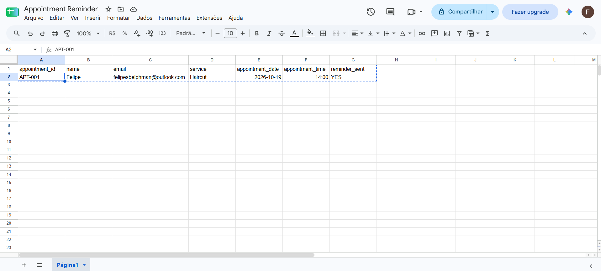
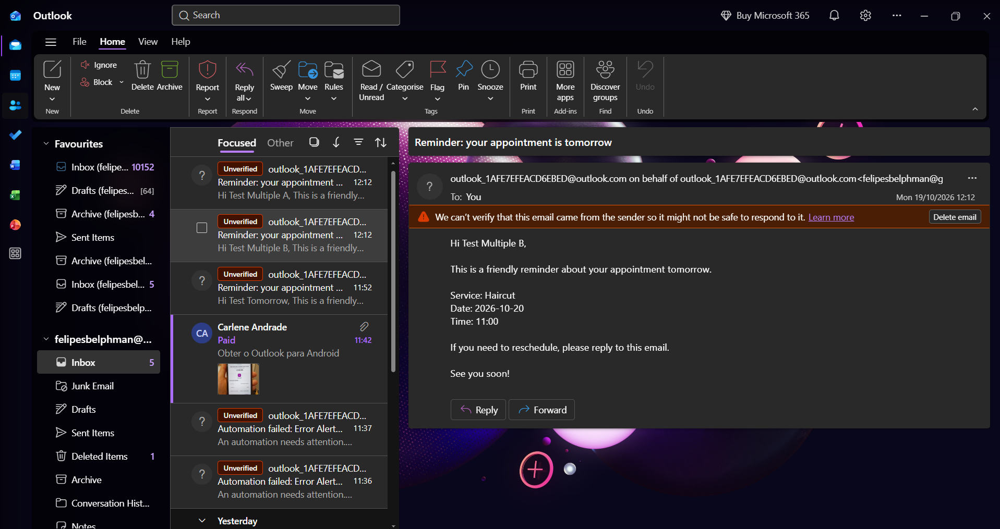
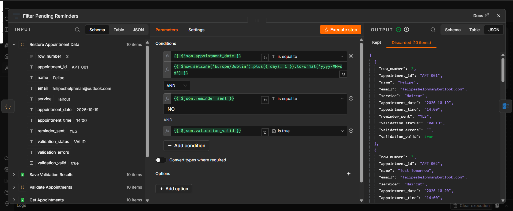
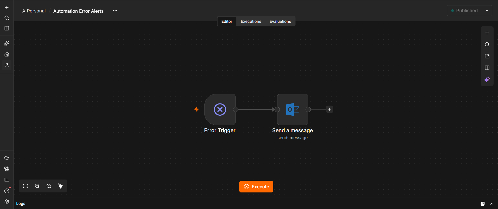
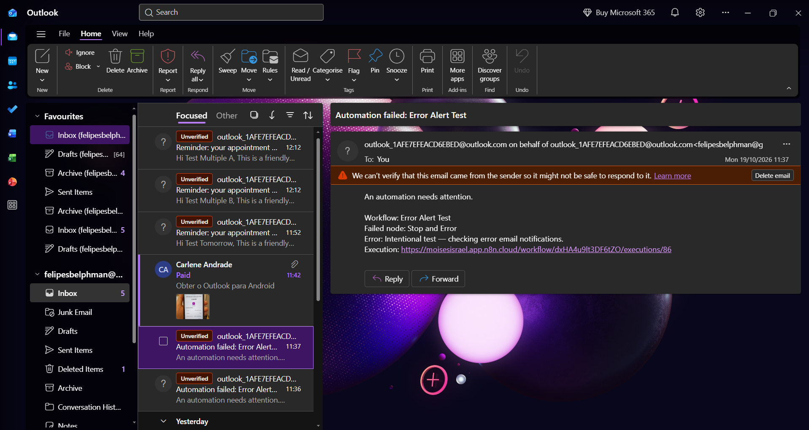

# Appointment Reminder

Appointment reminder automation built with **n8n, Google Sheets and Microsoft Outlook**. Portfolio project with input validation, spreadsheet diagnostics and a separate error notification workflow.

## Business problem

Appointment-based businesses often send reminders manually. This workflow checks next-day appointments, sends personalized emails and records their status to reduce repetitive work.

## How it works

1. Runs manually or daily at **09:00 Europe/Dublin**.
2. Reads appointments from Google Sheets.
3. Validates IDs, email syntax and calendar dates; flags every occurrence of a duplicate ID.
4. Saves `VALID`/`INVALID` and error details to the original spreadsheet row.
5. Restores full appointment data using n8n item linking.
6. Keeps appointments for tomorrow with `reminder_sent = NO` and `validation_valid = true`, using AND.
7. Sends an Outlook reminder and marks the appointment `YES` by its unique ID.

Invalid data is recorded and filtered out; it does not deliberately fail the workflow. Execution failures are handled separately by **Automation Error Alerts**, which emails the workflow name, failed node, error and execution link when available.

## Files

- `appointment-reminder.json`: main workflow template.
- `automation-error-alerts.json`: separate Error Trigger → Outlook workflow.
- `appointments-example.csv`: fictional valid and invalid examples.

Templates are inactive and contain no original credential references, spreadsheet identifiers, personal recipients, pinned customer data or instance metadata. The original error-workflow ID was removed: link the imported workflows manually.

## Setup

1. Import both JSON files into a compatible n8n instance.
2. Import the CSV into a Google Sheets tab named `Appointments`. Keep all nine column headers. Store dates as plain text in `yyyy-MM-dd` format and times as `HH:mm`.
3. Change example appointment dates to tomorrow for your test, and replace example recipients with your own test email.
4. Configure Google Sheets credentials, document and tab in **all three** Sheets nodes. If needed, refresh column mappings after selecting the sheet.
5. In `Save Validation Results`, match `row_number` and update only `validation_status` and `validation_errors`.
6. In `Mark Reminder as Sent`, match `appointment_id` and update only `reminder_sent`.
7. Select Outlook credentials in both workflows. Set your alert recipient in `automation-error-alerts.json` through the node UI.
8. Save/publish the error workflow as required by your n8n version. In the main workflow's Settings → Error Workflow, select the imported Automation Error Alerts workflow, save and publish the main workflow after testing.
9. Confirm the main timezone is `Europe/Dublin` and schedule is 09:00 daily. The n8n instance must remain available for scheduled runs.

Keep both Code nodes on **Run Once for All Items**, with **Execute Once disabled**. Keep normal stop-on-error behavior on critical steps. Do not pin old test data when verifying fresh spreadsheet values.

## Manual verification

Run Get Appointments → Validate Appointments → Save Validation Results → Restore Appointment Data → Filter Pending Reminders first. Inspect Kept/Discarded before sending. Only use test recipients. After successful sends, run Mark Reminder as Sent and verify the matching rows in Google Sheets. Read fresh data and confirm sent appointments are discarded.

To test failure notifications, use a separate temporary Schedule Trigger → Stop And Error workflow linked to the error workflow. Trigger it automatically, confirm the alert, then unpublish the temporary test. Manual executions do not exercise the automatic error-workflow path.

## Tests observed during the guided build

| Scenario | Observed result |
|---|---|
| Tomorrow + NO + valid data | Selected for reminder |
| Already sent or another date | Discarded |
| Two pending valid appointments | Two Outlook success responses; both corresponding IDs updated to YES |
| Fresh read after those sends | Zero kept, eight discarded in that test dataset |
| Empty email | Invalid; blocked |
| Invalid date text | Invalid; blocked |
| Two rows with the same ID | Both invalid; blocked |
| Ten-row validation dataset | Six valid, four invalid; ten discarded with no eligible pending appointment |
| Spreadsheet diagnostics | Validation status/errors written by row number |
| Correct a missing email | Status changed to VALID and previous spreadsheet error cleared |
| Intentional scheduled failure | Error alert email received with workflow, node, error and execution link |

The final restored-data path was checked with ten records and no eligible sends. A positive end-to-end send through this final path has not yet been retested. These are guided manual tests of the original configured workflows, not automated tests or a production audit. Sanitized imports need a fresh configuration and test; regular 09:00 reminder execution has not been independently verified here.

## Scope and limitations

- Email syntax validation does not establish mailbox existence or deliverability.
- Missing IDs are checked in code but that case was not separately tested during this session.
- Names, service, time format, cancellation status and unexpected reminder status values are not fully validated.
- Row-number updates assume the sheet is not sorted or structurally edited during a run.
- YES prevents routine sequential repeat sends after a successful update; concurrent runs or an update failure after sending can still cause duplicates. This is not an exactly-once system.
- Outlook success indicates acceptance, not guaranteed final delivery.
- Do not configure the error workflow to call itself. If Outlook itself is unavailable, the Outlook-based alert can fail too.
- No automated retries, production monitoring SLA or WhatsApp integration is included.
- Rescheduling requires reviewing/resetting the reminder status. Invalid rows require manual correction.
- Hosting and connected accounts may have costs or quotas. No AI API is required.

## Screenshots

These screenshots show the original workflow version; refresh them to show v1.3 validation nodes and diagnostics.

### Appointment tracking

### Email reminder

### Repeat-send filtering

### Error notification workflow
Separate workflow that receives execution errors and sends an Outlook alert.

### Error alert email
Test alert showing the workflow, failed node and error message.

